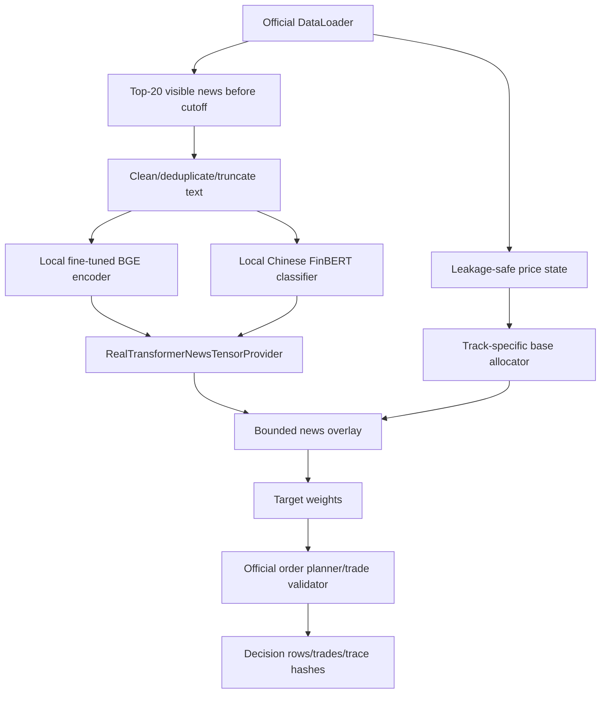
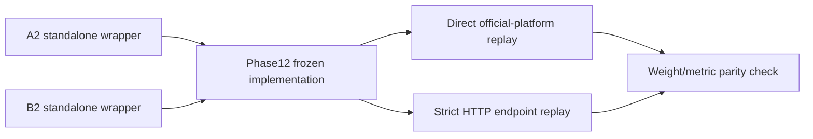
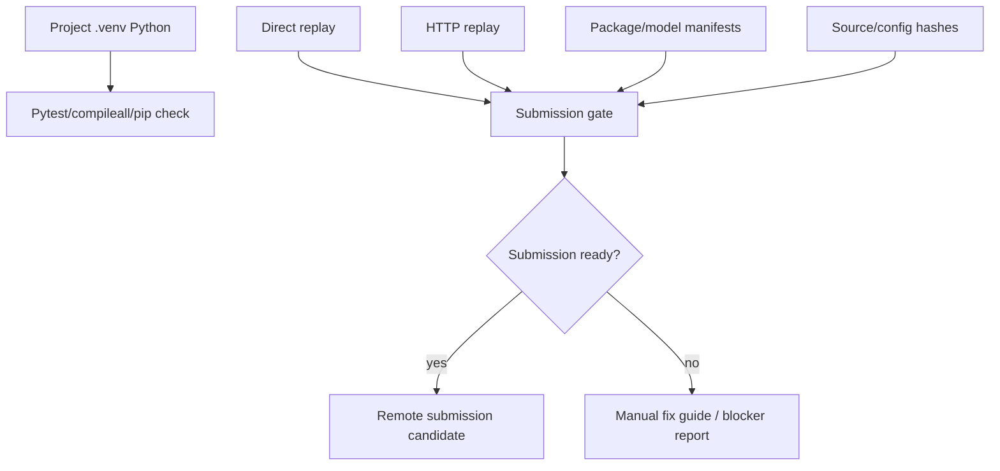

# Prompt10 — Official HTTP Run, Package-Clean Repair, and Final A2/B2 Submission Reports

You are GPT-5.5 Thinking / Codex acting as a senior research-code auditor, official-runtime engineer, Python packaging fixer, and submission-readiness reviewer.

This is a **normal execution prompt, not `/goal` mode**.

Your job is to make the current standalone A2/B2 submission package as close as possible to official submission-ready. Focus on **HTTP official run/parity**, **project `.venv` compile/pip checks**, **remaining package caveats**, and **final Track A/B system reports**.

Do **not** do new alpha mining, new model selection, new fine-tuning, Prompt06 grid search, or hidden-2026 access.

---

## 0. Hard Rules

1. Source of truth:
   - Track A candidate: `A2_real / G11A`
   - Track B candidate: `B2_real / G15B`
   - Current baseline: `phase12_final`
   - A0/B0 are reference controls only.
   - Prompt06/07b are research-only and must not be production-loaded.
2. No hidden 2026 access.
3. No 2025 tuning or candidate selection.
4. No online API calls, model downloads, or remote inference.
5. No fake/proxy/fixed-target replay.
6. Do not claim strict HTTP parity unless actual HTTP endpoint decision rows are produced and match direct replay.
7. Do not claim package-clean unless compileall and pip check pass under the **project `.venv` Python**, not the system Python used by `rtk`.
8. If something cannot be fixed, write a precise failure report and an exact manual guide.
9. Preserve current production behavior unless a change is only for packaging/runtime invocation and parity is proven.
10. Keep everything evidence-driven: configured is not executed; direct replay is not HTTP; local import is not official run; smoke is not full replay.

---

## 1. Required Input Review

Read these before changing anything:

```text
AGENTS.md
README.md
rtk-optimized.md
NLPCC_tasks/agent_platform/agents/build_agent.py
NLPCC_tasks/agent_platform/agents/phase12_final_agent.py
NLPCC_tasks/agent_platform/agents/phase12_final_candidate_config.json
NLPCC_tasks/agent_platform/agents/prompt09_real_transformer_agent.py
src/nlpcc/news_overlay/production_tensor.py
NLPCC_tasks/server_platform/app/core/data_loader.py
outputs/reports/next_phase_finetuning_phase12/prompt09_submission_packaging_standalone_agents
outputs/reports/next_phase_finetuning_phase12/prompt08_major_production_hardening_phase12
outputs/reports/next_phase_finetuning_phase12/prompt04_goal_integrate_optimize_official_clean
outputs/reports/next_phase_finetuning_phase12/prompt03a_goal_bge_contrastive_relevance
```

Also locate the standalone A2/B2 agent files created by Prompt09 and inspect their import paths, model artifact references, and official platform entry points.

---

## 1B. System-Report and NLPCC Template Style Requirements

This prompt must revise the final system reports into a paper-style system report, not just an internal engineering note.

### 1B.1 Required style references to inspect

Read and summarize these local template/style files if present:

```text
docs/NLPCC2026 - Template/**
docs/NLPCC2026 - Template/readme.txt
docs/NLPCC2026 - Template/samplepaper.tex
docs/NLPCC2026 - Template/llncsdoc.pdf
docs/NLPCC2026 - Template/splncs04.bst
```

If the files are located elsewhere, find them by name. If a file is missing, record it as `missing_template_file` rather than inventing rules.

Also read the task-specific system-report guidance if present:

```text
NLPCCSharedTask4演示与答疑.md
README.md
NLPCC_tasks/README.md
```

Create:

```text
reports/template_style_intake_summary.md
reports/template_compliance_checklist.csv
reports/system_report_section_plan.csv
```

`template_compliance_checklist.csv` columns:

```text
requirement_source
requirement
applies_to
status
how_addressed
missing_or_blocked_reason
```

### 1B.2 General system-description paper standard

Use the following general standard when rewriting the reports:

```text
A good shared-task system report should allow another researcher or organizer to:
1. understand the task and track setting without prior project memory;
2. identify exactly which system was submitted;
3. reimplement the method from the paper-level description;
4. reproduce the reported frozen-evaluation results from the supplied package/environment;
5. understand strengths, weaknesses, ablations, and known failure modes;
6. distinguish official/direct/HTTP results from local research diagnostics;
7. distinguish production-loaded methods from research-only experiments.
```

### 1B.3 Required LNCS-style report shape

Rewrite the combined report in a Springer/LNCS-like system-paper structure. Use English unless a local template or organizer instruction explicitly requires Chinese.

Create these report drafts:

```text
reports/SYSTEM_REPORT_LNCS_DRAFT.md
reports/SYSTEM_REPORT_LNCS_DRAFT.tex
reports/TRACK_A_FINAL_SYSTEM_REPORT.md
reports/TRACK_B_FINAL_SYSTEM_REPORT.md
reports/SYSTEM_REPORT_REPRODUCIBILITY_APPENDIX.md
reports/SYSTEM_REPORT_CLAIMS_AND_LIMITATIONS.md
```

The combined LNCS-style draft must use this section plan unless the local template clearly requires otherwise:

```text
Title
Abstract
Keywords
1 Introduction
2 Task Setting and Data Contract
3 System Overview
4 Methodology
  4.1 Shared Decision-Time News Tensor
  4.2 Track A Macro-Asset Allocation Agent
  4.3 Track B Sector-Rotation Agent
  4.4 Bounded News Overlay and Trade Generation
5 Experimental Setup
  5.1 Frozen Splits and Evaluation Protocol
  5.2 Official/Direct/HTTP Runtime Modes
  5.3 Implementation and Environment
6 Results
  6.1 Track A Frozen 2025 Results
  6.2 Track B Frozen 2025 Results
  6.3 Ablation and Shuffle Controls
7 Reproducibility and Submission Package
8 Limitations and Risk Controls
9 Future Work
10 Conclusion
References
Appendix A: Exact Configuration and Hyperparameters
Appendix B: Package Manifest and Reproduction Commands
```

### 1B.4 Style requirements for final writing

The report must be clear, conservative, and evidence-backed.

Required writing style:

```text
- Do not write like an implementation log.
- Do not write like a prompt history.
- Do not over-explain every failed research branch in the main body.
- Place failed Prompt06/07b research in Limitations or Appendix only.
- Use tables for Track A vs Track B identity, performance, and ablations.
- Use diagrams for runtime architecture and packaging architecture.
- Use equations where they clarify the method.
- Explain all acronyms on first use.
- Use precise caveats: direct replay is not HTTP; package dry-run is not remote submission.
- Keep method claims aligned with `METHOD_CLAIMS_ALLOWED_AND_FORBIDDEN`.
```

### 1B.5 Required system-report content mapped to NLPCC task guidance

The system report must explicitly cover:

```text
Agent architecture design:
  - official DataLoader -> visible price/news state -> local BGE/FinBERT tensor -> base allocator -> bounded overlay -> official order planner.

Core innovation strategy:
  - local-only real transformer news tensor;
  - leakage-safe decision-time filtering;
  - Track A risk-parity plus bounded news overlay;
  - Track B S1 sector core plus bounded event/news overlay;
  - reproducibility and fail-closed model loading;
  - risk controls: caps, turnover, cash/trade semantics.

Future work:
  - improve Track B evidence;
  - fix strict HTTP runtime;
  - package-clean reproducible environment;
  - optional future BGE/FinBERT feature-store work without hidden-2026 leakage.
```

### 1B.6 Required reporting boundaries

The reports must distinguish:

```text
production-loaded:
  phase12_final, standalone A2/B2 wrappers, Prompt03a fine-tuned BGE checkpoint, local FinBERT, RealTransformerNewsTensorProvider, official order planner.

research-only:
  Prompt06 alpha grid, Prompt07b repaired BGE factor panel, broad factor-mining diagnostics.

validated:
  standalone direct frozen-2025 parity and direct replay.

blocked:
  strict HTTP parity, package-clean compileall/pip checks until fixed, remote official submission.
```

### 1B.7 Required figures/tables for the system report

Create Mermaid diagrams in `reports/ARCHITECTURE_REFERENCE.md` and include image/figure references in the `.tex` draft if possible.

Required tables:

```text
Table 1: Track identity and selected candidates.
Table 2: Data contract and leakage controls.
Table 3: Shared transformer tensor fields.
Table 4: Track A vs Track B allocation formula summary.
Table 5: Frozen 2025 direct replay metrics.
Table 6: Ablation and shuffle-control summary.
Table 7: Runtime/package status: direct, HTTP, compileall, pip check, model artifact delivery.
Table 8: Allowed vs forbidden claims.
```

### 1B.8 Required final style audit

Create:

```text
reports/system_report_quality_audit.csv
reports/system_report_missing_items.md
```

`system_report_quality_audit.csv` columns:

```text
item
status
where_addressed
evidence_file
fix_needed
```

Audit at minimum:

```text
abstract present
keywords present
standalone task description present
Track A/B separated
production-loaded vs research-only separated
official/direct/HTTP status separated
figures present
equations present
ablations present
limitations present
future work present
reproducibility appendix present
LNCS template checked
no forbidden claims
```

---

## 2. Output Folder

Write all outputs under:

```text
outputs/reports/next_phase_finetuning_phase12/prompt10_http_package_clean_final_submission/
```

Required subfolders:

```text
audit/
http/
direct/
package/
models/
tests/
reports/
guides/
hashes/
logs/
presented/
presented/run_csv/
```

---

## 3. Python Environment Rule: Use Project `.venv`, Not `rtk` System Python

The previous package checks used the wrong large/system Python environment. This prompt must explicitly detect and use the project `.venv`.

### 3.1 Detect Python candidates

Create `audit/python_environment_discovery.csv` with:

```text
candidate_name
path
exists
python_version
prefix
base_prefix
is_venv
can_import_project
notes
```

Check at least these Windows/Linux candidates:

```powershell
.venv\Scripts\python.exe
venv\Scripts\python.exe
.env\Scripts\python.exe
python
py -3
```

```bash
.venv/bin/python
venv/bin/python
.env/bin/python
python3
python
```

### 3.2 Select interpreter

Selection rule:

```text
Prefer .venv/Scripts/python.exe or .venv/bin/python if it exists and can import project modules.
Do not use rtk python for compileall/pip check unless no project .venv exists.
```

Write selected interpreter to:

```text
audit/selected_python_environment.json
```

Fields:

```text
selected_python
selected_reason
python_version
sys_prefix
sys_base_prefix
pip_version
project_import_smoke_status
```

---

## 4. Strict HTTP Official Run / Parity

### 4.1 Find official server commands

Inspect README, AGENTS, server files, and existing scripts to identify how the official local server is intended to run.

Create:

```text
http/http_command_candidates.csv
```

Columns:

```text
candidate_id
command
working_directory
python_interpreter
source_file_or_doc
expected_port
status
notes
```

### 4.2 Attempt HTTP run from shell first

Using the selected project `.venv` Python, try to start the official server or app through the documented command.

Record:

```text
http/http_server_startup_attempts.csv
http/http_server_stdout.log
http/http_server_stderr.log
http/http_server_process_status.json
```

If the server starts, run HTTP endpoint decisions for at least:

```text
A0 reference control
B0 reference control
A2_real standalone
B2_real standalone
```

Prefer the same 2025 frozen replay dates used by Prompt09. If full replay is too slow, first run a 3-date smoke, then full 243-date run if smoke passes.

Required HTTP outputs:

```text
http/strict_http_decision_rows.csv
http/http_frozen_2025_results.csv
http/http_daily_weight_trace.csv
http/http_trade_schema_validation.csv
http/http_vs_direct_weight_diff.csv
http/http_vs_direct_metric_diff.csv
```

Parity pass condition:

```text
max_abs_weight_diff <= 1e-12 for each date/fund/candidate, or exact hash match if the platform uses deterministic rounded output.
metrics equal within 1e-10.
trade schema valid for every date.
```

### 4.3 If shell HTTP fails, try computer use / PyCharm path

If shell HTTP cannot start but the environment supports computer use, explicitly use computer use:

1. Open PyCharm for this repo.
2. Open the integrated terminal.
3. Activate the project `.venv`.
4. Run the official server command identified above.
5. In a second terminal, run the HTTP replay command.
6. Save stdout/stderr and output CSVs to the Prompt10 folder.

Record:

```text
http/computer_use_attempt_log.md
http/pycharm_terminal_command_guide.md
```

### 4.4 If computer use is unavailable or still fails

Do not claim HTTP parity. Produce a manual guide:

```text
guides/OFFICIAL_HTTP_RUN_MANUAL_GUIDE.md
```

It must contain:

- exact working directory;
- exact `.venv` activation command;
- exact server command;
- exact replay command;
- expected output files;
- expected pass/fail criteria;
- common failure causes;
- what logs to upload next.

---

## 5. Compileall and Pip Check Repair Under `.venv`

### 5.1 Compileall

Run compileall under selected `.venv` Python:

```powershell
.venv\Scripts\python.exe -m compileall src NLPCC_tasks tests
```

or Linux equivalent:

```bash
.venv/bin/python -m compileall src NLPCC_tasks tests
```

Write:

```text
tests/compileall_project_venv_results.csv
tests/compileall_stdout.log
tests/compileall_stderr.log
```

If failure is due only to permission writing `__pycache__`, try safe alternatives:

```text
set PYTHONDONTWRITEBYTECODE=1 and run import smoke tests instead
use a temporary writable PYTHONPYCACHEPREFIX under outputs/reports/.../tmp_pycache
run compileall with legacy/invalidation options only if supported
```

Do not modify source files just to suppress errors unless the source truly has syntax problems.

### 5.2 Pip check

Run:

```text
<selected_python> -m pip check
<selected_python> -m pip freeze > package/pip_freeze_project_venv.txt
<selected_python> -m pip list --format=json > package/pip_list_project_venv.json
```

Write:

```text
tests/pip_check_project_venv_results.csv
tests/pip_check_stdout.log
tests/pip_check_stderr.log
package/pip_freeze_project_venv.txt
package/pip_list_project_venv.json
```

If pip check fails, classify each issue:

```text
missing_dependency
version_conflict
irrelevant_optional_package
submission_blocker
safe_to_ignore_with_reason
```

Create:

```text
package/dependency_conflict_triage.csv
package/requirements_repair_suggestion.md
```

If safe and local, install missing small pure-Python package only when it is already in project requirements/lock docs. Do not upgrade/downgrade major packages blindly.

---

## 6. Remaining Caveats Closure

Address these remaining caveats explicitly.

### 6.1 Fine-tuned BGE model artifact delivery

Inspect whether the fine-tuned BGE checkpoint is copied into the standalone submission package or only referenced as local path.

Create:

```text
models/model_artifact_delivery_audit.csv
models/bge_delivery_decision.md
```

Classify:

```text
bundled_in_package
relative_path_reference
absolute_local_path_reference
hf_cache_required
missing
```

If allowed and practical, copy only required fine-tuned BGE files into package artifacts using relative paths. If not possible, write exact instructions and fail-closed behavior.

### 6.2 Track B caveat

Do not hide B2 weakness. Update final reports to state:

```text
B2 is packaged by fixed candidate policy and standalone parity, not because it beats B0/zeroed/shuffled controls.
```

### 6.3 A2 caveat

Track A should be described as:

```text
modestly positive versus A0/zeroed, but not robust under block-shuffle controls.
```

### 6.4 Prompt06/07b exclusion

Verify standalone agents do not import Prompt06 alpha grid or Prompt07b factor panel.

Create:

```text
audit/research_artifact_import_scan.csv
```

---

## 7. Graphical Architecture Reference

Create graphical architecture references in Markdown using Mermaid diagrams.

Files:

```text
reports/ARCHITECTURE_REFERENCE.md
reports/TRACK_A_FINAL_SYSTEM_REPORT.md
reports/TRACK_B_FINAL_SYSTEM_REPORT.md
```

`ARCHITECTURE_REFERENCE.md` must include at least:

### 7.1 Runtime architecture



### 7.2 Packaging/parity architecture



### 7.3 Evidence gate architecture



---

## 8. Full Rigorous Mathematical Modeling Section

The Track A and Track B final system reports must include a rigorous, explicit mathematical section.

### Required notation

Define:

```text
D_t: decision date
A: asset/fund universe
N_t: visible news set on decision date t
p_{i,t}: price features available at decision time
x_k: BGE embedding of news article k
q_j: BGE embedding of asset/sector query j
r_{k,j}: relevance
s_k: FinBERT sentiment score
c_k: FinBERT confidence
u_k: normalized uncertainty
h_k: recency half-life weight
w^base_t: base allocation
z_{j,t}: raw news score
Delta w_t: centered bounded news overlay
w_t: final target weight
```

### Required equations

Include these equations and match them to implementation:

```text
r_{k,j} = max(0, <normalize(x_k), normalize(q_j)>)
h_k = 0.5^(age_days(k,t)/2)
a_{k,j,t} = r_{k,j} h_k / sum_l r_{l,j} h_l
sentiment_k = P_k(pos) - P_k(neg)
confidence_k = max_c P_k(c)
uncertainty_k = H(P_k) / log(C)
z_{j,t} = relevance_{j,t} sentiment_{j,t} confidence_{j,t} event_confidence_{j,t} recency_{j,t} max(0, 1 - uncertainty_{j,t})
Delta w_{j,t} = cap_L1(center(z_t), overlay_cap)
w_t = normalize_0.97(project_long_only(w^base_t + Delta w_t))
```

For Track A risk parity include:

```text
Sigma_t = (1-alpha) S_t + alpha T_t
RC_i(w) = w_i (Sigma_t w)_i / (w^T Sigma_t w)
w_i <- project_capped(w_i sqrt((1/n) / max(RC_i, eps)))
```

For Track B S1 core include:

```text
w_raw = 0.35 w_inverse_vol + 0.15 w_momentum + 0.50 w_sector_trend
w_adj,i = w_raw,i max(0, 1 - 0.35 drawdown_penalty_i)(0.75 + 0.50 breadth_i)
```

Also include invariants:

```text
long-only
sum weights = 0.97 final invested target
per-asset cap enforced
L1 overlay cap enforced
turnover cap enforced
no same-day close/high/low leakage
no same-day sale proceeds reused for buys
local_files_only=True
fail closed if model artifact missing
```

Do not state formal theorems unless proved. State this is an empirical system with enforceable invariants, not a theoretical alpha proof.

---

## 9. Final Reports and Presented Files

Create:

```text
reports/FINAL_HTTP_AND_PACKAGE_CLEAN_REPORT.md
reports/TRACK_A_FINAL_SYSTEM_REPORT.md
reports/TRACK_B_FINAL_SYSTEM_REPORT.md
reports/COMBINED_FINAL_SUBMISSION_READINESS_REPORT.md
reports/METHOD_CLAIMS_ALLOWED_AND_FORBIDDEN_FINAL.md
reports/SUBMISSION_GAP_SUMMARY_FINAL.md
```

Create dense monitor files:

```text
presented/prompt10_key_metrics.csv
presented/prompt10_merged_evidence.csv
presented/prompt10_source_artifact_index.csv
presented/essential_results.md
presented/blockers_and_decisions.md
presented/implementation_log.md
presented/progress_dashboard.md
```

Also copy the most important CSVs into `presented/run_csv/`:

```text
python_environment_discovery.csv
selected_python_environment.csv or json flattened
strict_http_decision_rows.csv if available
http_vs_direct_metric_diff.csv if available
http_vs_direct_weight_diff.csv if available
compileall_project_venv_results.csv
pip_check_project_venv_results.csv
dependency_conflict_triage.csv
model_artifact_delivery_audit.csv
research_artifact_import_scan.csv
standalone_weight_diff_summary.csv
frozen_2025_standalone_results.csv
```

---


### 9B. System Report Finalization Gate

Before finalizing Prompt10, run a report-specific gate:

```text
reports/system_report_quality_audit.csv must have no `fail` rows for:
  abstract present
  keywords present
  task setting clear
  method reproducible
  Track A/B separate
  direct/HTTP distinction clear
  limitations present
  no forbidden claims
  template files inspected or missing recorded
```

If any item fails, repair the report draft before writing final presented files. If a local template file is missing, record `blocked_missing_template_file` but still produce a best-effort LNCS-style report.


## 10. Required Final Decision Logic

Final decision states must be one of:

```text
submission_ready
submission_ready_direct_only_http_blocked
package_blocked_http_blocked
package_blocked_dependency_only
failed
```

Use:

- `submission_ready` only if HTTP parity passes and compileall/pip check pass under `.venv`.
- `submission_ready_direct_only_http_blocked` only if direct replay and packaging pass but HTTP remains blocked and package checks pass.
- `package_blocked_http_blocked` if HTTP is blocked and package checks are not clean.
- `package_blocked_dependency_only` if HTTP passes but package checks fail.
- `failed` if standalone parity breaks or production behavior changes unexpectedly.

---

## 11. Final Response Format

At the end, report exactly:

```text
A. What Changed
B. HTTP Official Run Status
C. Python Environment / Package Status
D. Model Artifact Delivery Status
E. Track A Final System Report Status
F. Track B Final System Report Status
G. Remaining Caveats
H. Final Submission Readiness Decision
I. Files to Upload for Audit
```

For each section, cite exact output files and rows/counts where possible.

Do not overclaim. If HTTP cannot be run, give exact guide path and next command.
